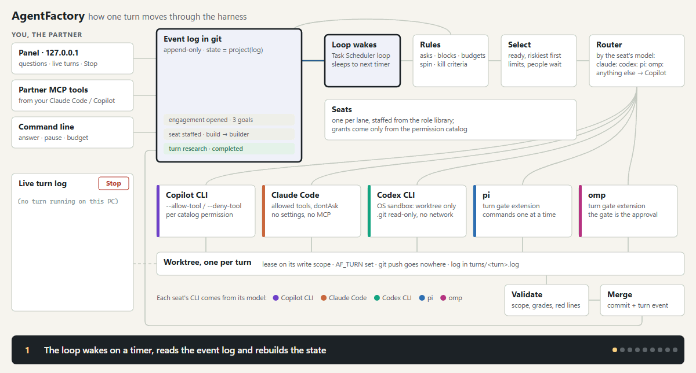

# AgentFactory

A git-native system for running a firm of AI agents with one human partner. It has a shared context layer; a challenge process that takes a hard problem to a tested MVP; a long-running harness that keeps engagements moving for months without a human acting as the clock; an Observator → Solver → Evaluator self-evolution loop; decision rights that route each decision to its owner (client, partner or lead); a role factory that staffs teams from a tested library; and an escalation policy that only brings key decisions to a human. The delivery loop is modeled on the RulTriX RSCL/Raee concept and built on plain git. The full design is in the "Agent firm design" doc.



The same diagram plays in a browser from `docs/architecture.html`.

This repo is the MVP. Zero dependencies. Node ≥ 22.18 (built-in TypeScript stripping, `node:sqlite`, `node:test`) and git ≥ 2.32.

```bash
npm test                     # foundation, harness, units, hooks, MCP, factory, load test, end-to-end scenarios
npm run demo:challenge       # the foundation: a challenge from frame to tested MVP
npm run demo:harness         # the long-running harness: six engagements simulated over months
npm run demo                 # the delivery engine (add --verbose for the event log)
```

## Foundation: from a hard problem to a tested MVP

Everything else builds on how a team takes on a challenge: frame it, generate options from different angles, critique them, decide, and build the smallest thing that tests what the decision depends on. Every stage reads and writes typed entries in the shared context layer (`src/foundation/`).

**Entries are claims, not chat.** Each entry has a type, an author and the angle it speaks for, links to what it builds on or attacks, a visibility, and a status:

- types: frame, question, evidence, option, assumption, critique, score, decision, plan, experiment, artifact
- never edited; a change is a new entry that replaces the old one, so the history of what was believed stays intact
- stored as files in git, so they're versioned and reviewable

**Angles are configured, not role-played.** An angle in `policy/angles.json` sets:

- what it's scored on (its objective)
- which evidence it reads (tags)
- which model family runs it

A prompt like "be the skeptic" changes the voice; different objectives, evidence and models change the reasoning.

**Divergence is sealed.** Angles that see each other's ideas anchor on the first plausible one, the same reason people generating ideas alone beat interactive brainstorming groups. Each angle's submission goes to its own git ref, `refs/sealed/<challenge>/<angle>`, never to the main line, and only a hash of it is recorded there. At reveal every submission is checked against its hash and all of them land in one commit. A submission changed after its commitment fails the check, and a second submission from the same angle is refused.

| Stage | Gate | What it prevents |
|---|---|---|
| Frame | the owner confirms the problem and criteria before any option exists; a challenger angle questions the frame first | solving the wrong problem; moving the goalposts later |
| Diverge | sealed; refs to anything outside the angle's view are refused; option budget per angle | anchoring, peeking, idea floods |
| Critique | never critique your own option; a critique needs evidence or a test, or it's discarded | self-review, critique theater |
| Score | never score your own option; scores must carry the frozen criteria hash | self-promotion, shifting criteria |
| Converge | only the owner decides; every rejected option needs a reason; scores inform but never pick | voting among agents whose errors are correlated |
| Plan MVP | assumptions ranked by risk × uncertainty; the top ones become versioned basis | building what's easy instead of testing what's risky |
| Experiment | a refuted assumption reopens the decision built on it, asks the owner, and marks pinned work stale | carrying on after the premise broke |

Claims are fact-checked by lookup: `repo:` sources must exist, `entry:` sources must resolve, and prose sources stay "unverified".

**The first challenge** is a real AgentFactory design question: how the cross-repo contract registry should work (`challenges/contract-registry.json`). `npm run demo:challenge` runs it from a fixture script and writes the full record to `challenges/out/contract-registry.md`. The fixture was written by one author to exercise the gates, including deliberate violations: a peek at another angle's option, an over-budget option, a self-critique, a critique with nothing behind it, a self-score and a stale criteria hash. Its content has none of the independence of a real run.

**Running a challenge for real** with model-backed angles, one owner gate at a time. Each angle runs as a fresh headless Copilot CLI session that sees only its own view and can't write files:

```bash
npm run challenge -- start challenges/contract-registry.json --runner copilot
npm run challenge -- confirm --by partner                # optionally --reframe "..."
npm run challenge -- decide --by partner --chosen <option> --reject "<option>=<reason>" ...
npm run challenge -- build
npm run challenge -- experiment --assumption <id> --result supported|refuted --method "..." --evidence "..."
npm run challenge -- report
```

State lives in git under `.af/<challenge>/`, so each command picks up where the last stopped. Model names in `policy/angles.json` (`model-a`, `model-b`, `model-c`) are placeholders; set them to the families your Copilot plan offers, and give angles that must disagree different families.

## Long-running harness: from MVP to months of work

After the challenge decides, the harness keeps the engagement moving (`src/harness/`, design and findings in [docs/harness.md](docs/harness.md)). Each wake starts from git, does at most a few bounded turns, checks them independently, commits, and says when to wake next. A person is asked only for decisions that are theirs, for money, and for work only a person can do.

What it rests on:
- **Belief is computed from evidence, never claimed.** Agents can record opinions and sourced reports; measurements come from jobs, behavior from metric sources, expert judgment from people listed as experts. Each kind of risk accepts its own grades (behavior for demand, experts for safety).
- **The riskiest open assumption picks the next work**, so the phase (demand, feasibility, compliance...) is derived, not configured. Work that assumes something waits until it's supported.
- **Questions block only what depends on them.** Everything else keeps moving while a regulator, a lawyer or another team takes weeks.
- **Spin is measured by outcome**: three turns without evidence or checked output force a replan; every todo has a turn cap; failed turns still cost.
- **Waiting is free**: jobs, market tests, calendar freezes and people's answers cost no turns, and a quiet wake is one `git ls-remote`.
- **The team follows the work.** Each lane with open work in a goal gets a seat, staffed from the firm library (researcher, builder, experimenter, strategist...) with permissions filtered through the catalog. A lane the library doesn't cover gets a generated role with the least access, on probation: an independent reviewer on another model checks its work unless a checker or a named person already does.

It was designed against six engagements, simulated end to end through the real code: an Unreal-6-scale engine, Starship 3D-printing kits for kids, a medicine assistant for seniors, a legacy migration, an open research question, and perpetual library maintenance. The simulations found ten design flaws, each fixed and now covered by a test.

## Components

| Component | File | What it does | Production swap |
|---|---|---|---|
| Git substrate | `src/git.ts` | Worktrees, commit trailers (`Agent`, `Basis`, `Config`, `Replay`, `Decision`), leases as refs under `refs/leases/<path>` acquired by one atomic push with `--force-with-lease=<ref>:` | GitHub Enterprise remote; same mechanics |
| Entries and sealed reveal | `src/foundation/entries.ts`, `seal.ts` | Typed append-only claims; per-angle sealed refs with hash commitments; views scoped by angle and evidence tags; dependents across versions | Same |
| Partner's panel | `src/panel/` | One local page over every engagement: the questions waiting on you, answered in place; per engagement, its beliefs, budget, open work, team and recent turns, the loop's last wake; pause, resume, a new budget. Reads and writes the same event log as the CLI | Same, plus a sign-in to reach it from a phone |
| Long-running harness | `src/harness/` | Event log in git, in causal order; beliefs from graded evidence; risk-ordered selection; dependency-scoped gates; claims as refs; jobs, waits, actions, monitors; kill criteria, budgets, spin and turn caps; seats staffed per lane from the library, generated roles on probation; deterministic handoff packet; tick/loop CLI; Copilot CLI and Claude Code turn agents run as the seat, routed by model; usage limits waited out per vendor; live turn logs and stop; six simulated cases | Real job/metric providers (GitHub Actions, analytics) behind the same interfaces; a model-backed role generator behind the same limits |
| Challenge process | `src/foundation/process.ts`, `runners.ts`, `cli.ts` | Frame → diverge → reveal → critique → score → converge → plan MVP → build → experiment, with the gates above; scripted and Copilot CLI angle runners | Same, with the Copilot SDK |
| Shared context layer | `src/context.ts` | Versioned task basis, content-addressed source snapshots, per-role context bundles, `context.lock.json` per artifact | Same files; snapshot importers per source system |
| Decision records | `src/decisions.ts` | Chosen + rejected options, bound paths, staleness when bound paths change | Same |
| Index | `src/store.ts` | SQLite index rebuilt from committed git objects; disposable | Postgres fed by webhooks |
| Observator | `src/observator.ts` | Breakpoints = artifacts pinned to a superseded basis. A query, no model call | Same, plus an LLM pass for unpinned artifacts |
| Solver | `src/solver.ts` | Context Portfolio from a breakpoint or config change; freezes the criteria hash before any candidate exists | `solver` custom agent for non-trivial revisions |
| Evaluator | `src/evaluator.ts` | Replays baseline vs candidate at a frozen commit, N runs per side in parallel; checks outcome, red lines, cost; rejects candidates that touch protected files; engagement-specific checkers plug in by name | Same, runs on CI runners |
| Fact-checker | `src/factcheck.ts` | Verifies claims by lookup (basis version, decision freshness, contract registry, CI result, file presence) | `fact-checker` agent maps free text to claim kinds |
| Policy | `src/policy.ts`, `policy/escalation-policy.json` | Triage (triggers, auto-resolve conditions, evolution rules, `never_auto` floor), decision rights and owner routing, engagement profiles, attention budget with backpressure | Same |
| Role factory | `src/factory.ts`, `src/harness/team.ts`, `policy/library.json`, `policy/permission-catalog.json` | Staffs a team from library templates, one agent per module, and the harness's seats lane by lane; generated roles and skills start on probation; permissions only from the catalog, so client text can raise a question but never grant access | Model-backed planner behind the same guardrails |
| Escalation log | `src/escalation-log.ts` | One event file per triage and per brief delivery under `.agents/escalations/<proposal>/`, with a feature snapshot for offline replay and the brief's position in the day; indexed by `store.ts`. Records only, never changes routing. `pickBlind` sends 20% of briefs without the recommendation; `pickAudit` sends one auto-resolved proposal a day back as a blind question, favouring ones near a threshold; outcome events with cause `input_misreport` count as the agent's missed escalations in the trust ledger. `escalation_quality.miss_cost_ratio` (k = 10) sets the calibration line: escalate when the chance the human changes the outcome is above 1/k | Same |
| Briefs | `src/brief.ts` | One-screen brief, blind variant | Same |
| Trust ledger | `src/ledger.ts` | Per-agent commits, revert rate, line survival (git blame), demotion | Same, plus missed-escalation counts |
| Coordinator | `src/orchestrator.ts` | Concurrency cap, lease → worktree → agent → lockfile → commit → merge queue → release. The merge queue runs the checks again when it rebases a change onto work that landed meanwhile, and lands a failure record instead of a combination that fails | Temporal workflows (durable waits, retries) |
| Agent runners | `src/agents/` | `MockAgent` (deterministic, tests) and `CopilotCliRunner` (`copilot -p --agent --model --allow-tool --deny-tool`) | Copilot SDK |
| MCP servers | `src/mcp-server.ts`, `src/harness/mcp.ts`, `src/mcp-rpc.ts` | Context layer as MCP tools over stdio, role-scoped, for agents; the partner's harness tools for their own session, refused inside turns; hand-written JSON-RPC | Same, or the official SDK |
| Copilot CLI integration | `integrations/copilot/` | Custom agents, hooks (`preToolUse` lease enforcement, `sessionEnd` lockfile), MCP config | Copy into your repo |

## The test scenario

1. Three agents build in parallel on basis v1 (enterprise + individual). The analyzer and a docs task overlap on `tools/`, so one waits for the lease.
2. Narrowing scope to enterprise-only is a basis change, so it escalates and the human gets a brief (and a blind variant). The human approves it, which writes basis v2 and decision D-0002.
3. agent-01 rebuilds the report on v2; agent-03 doesn't.
4. The Observator finds exactly one breakpoint: the analyzer is pinned to `scope@v1`.
5. The Solver proposes a portfolio and the Evaluator replays it 3 runs per side. The baseline passes 0% (individual records present). The candidate passes 100% at lower cost. All claims verify by lookup, the policy auto-resolves, the fix merges, and the breakpoints drop to zero.
6. The loop refuses what it should:
   - A config that leaks PII is revised once and then passes.
   - A cost regression (+150%) has no remedy, so it escalates.
   - A candidate that edits the frozen criteria is rejected.
   - A criteria-edit PR hits the `never_auto` floor.
   - A contract change with an unverifiable consumer claim plus dissent escalates, with both shown in the brief.
7. Trust ledger: reverting agent-04's commit demotes it, computed from git history alone. A decision goes stale when its bound path is edited.
8. Attention budget: 8 briefs a day are delivered, 2 are queued, interrupts bypass the cap, and backpressure turns on.
9. Lease atomicity: an overlapping lease is refused by the pre-check, and also by git itself when the pre-check is bypassed. Expired leases are reaped.

Plus a load test (12 agents, 4 slots, overlapping paths: no overlapping holders, every change merges, history is linear, every lease is released) and role-factory tests (one agent per module, injected access requests become questions, generated skills on probation, hand-edited plans rejected).

## Private engagements

An engagement that holds client-confidential material keeps its code in `src/<name>/`, its SOW and client files in `engagements/<name>/`, and its tests in `test/<name>.test.ts`. List those paths in `.git/info/exclude`, git's local-only ignore file, so they stay in your copy and the public repo never even names them. `npm test` runs their tests whenever they're present.

## Guides

Each guide is its own file, so a change to one feature touches only its own page. Add a new page for a new feature and a line here; don't grow this README.

- [Running the harness on Windows](docs/windows.md): Task Scheduler, `doctor`, and what's handled for Windows
- [Which CLI and model run a seat](docs/models.md): Copilot, Claude Code, Codex, pi or omp, and how each is held to its grant
- [Usage limits](docs/usage-limits.md): a limit is a wait, not a failure
- [The panel](docs/panel.md): the partner's page over every engagement
- [The desk](docs/desk.md): one page for all your Copilot CLI terminals, notes between them, and what their sessions teach kept in git (company-setup branch)
- [From your own Copilot or Claude Code session](docs/partner-tools.md): the partner's MCP tools
- [Memory about the people you serve](docs/memory.md): typed memory, what it may be used for, and how it expires
- [What testing found](docs/testing-findings.md)
- [Not real yet](docs/not-real-yet.md)
- [Harness design](docs/harness.md), against the six cases

## Plugging into Copilot CLI

1. Put this project at `tools/agentfactory/` in your repo.
2. Copy `integrations/copilot/.github/*` and `integrations/copilot/.agents/hooks/` to the repo root, and append `.gitignore.snippet` to `.gitignore`.
3. Use `CopilotCliRunner` instead of `MockAgent` in the coordinator.

Check these against your CLI version before relying on them:
- **Tool names:** the hook matches `edit|create|write|str_replace*` for file writes and `bash|shell|powershell` for shell.
- **Hook output:** the hook prints `{"permissionDecision":"allow"|"deny"}`.
- **`model:` in agent frontmatter:** model IDs depend on what your org enables.
- **Programmatic flags:** `--output-format json` and `--no-ask-user`.
