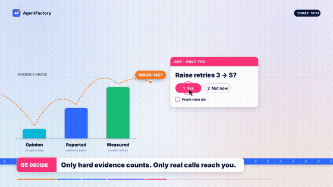
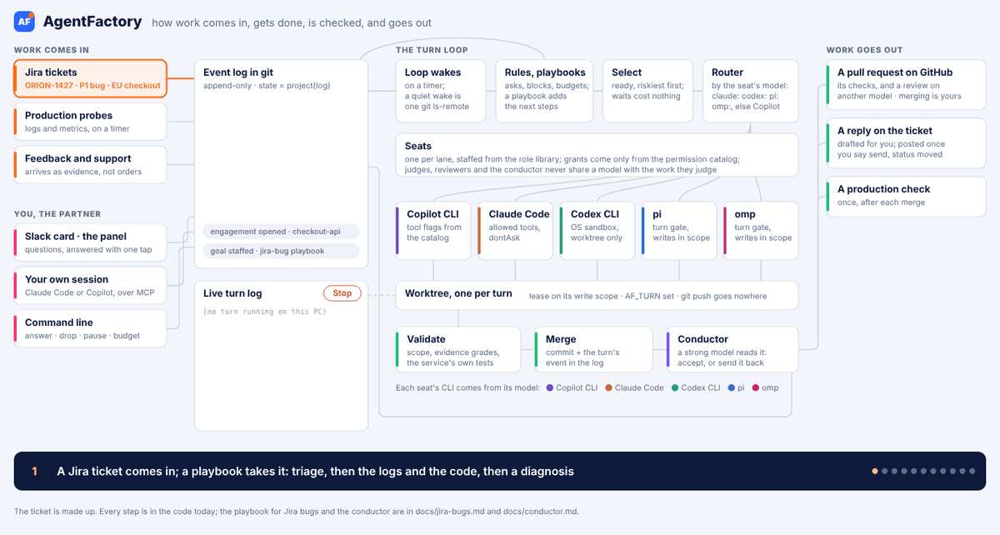

# AgentFactory

**A firm of AI agents that keeps working for months. You're the only human in it, and you only make the calls.**

   

<a href="docs/film/agentfactory.en.mp4"></a>

**▶ [Watch the 47-second film](docs/film/agentfactory.en.mp4)** · [中文版](docs/film/agentfactory.zh.mp4) · [what in it is real today](docs/film.md)

A P1 lands in Jira at 8:15. The fix is ready for your approval as a reviewed pull request by 10:49, and along the way it asked you one question. AgentFactory is built to make that ordinary. It pulls work in from Jira, alerts and feedback, staffs it with agents on the CLIs you already use, and checks their work on a different model. It keeps going for weeks, waking itself on timers.

## What makes it different

- **It interrupts you only for your calls.** Direction, money, closing a goal: the harness never decides those by itself. Everything else it does and records. Answer "from now on", and that answer becomes a rule.
- **Nothing is believed without evidence.** An agent can offer an opinion or a report, nothing stronger. Beliefs move on measurements, metrics and what people tell it.
- **No agent grades its own work.** Reviewers run on a different model from the workers, and the harness refuses to start if they don't.
- **Everything is in git.** Every event, answer and turn is an append-only log you can read, diff and replay. There's no database to look after.
- **It runs for months, not minutes.** Waiting for a job, a market test or a person costs nothing. A quiet wake is one `git ls-remote`, and a usage limit is a wait, not a failure.
- **Bring your own agents.** Each seat runs in GitHub Copilot CLI, Claude Code, Codex, pi or omp, held to the permissions its role is granted. No turn can push.

## How one turn moves



The same diagram plays in a browser from [`docs/architecture.html`](docs/architecture.html). The whole system, part by part, is in **[How it works](docs/how-it-works.md)**.

## Try it in a minute

No dependencies and no build: Node 22.18 or later, and git.

```bash
git clone https://github.com/AJ999999999/AgentFactory && cd AgentFactory
```

```bash
npm run demo:harness
```

That simulates six engagements over months, in seconds: an engine, a kids' product, a medicine assistant, a migration, open research and library upkeep. Then open the partner's page on them:

```bash
npm run panel -- --demo
```

To run it on real work, with Jira coming in, questions on Slack and pull requests going out on GitHub, follow [setting it up](docs/setup.md).

## Guides

<!-- Each guide is its own file, so a change to one feature touches only its own page. Add a new page for a new feature and a line here; don't grow this README. -->

- **Start here:** [how it works](docs/how-it-works.md) · [setting it up in the office](docs/setup.md) · [the film](docs/film.md) · [harness design](docs/harness.md), against the six cases
- **Work in and out:** [events from Jira](docs/events.md) · [done work as pull requests](docs/ship.md) · [questions on Slack](docs/harness-slack.md)
- **Your seat:** [the panel](docs/panel.md) · [the desk](docs/desk.md), every Copilot CLI terminal as a thread, with Ctrl+K between them · [the partner's MCP tools](docs/partner-tools.md)
- **Running it:** [which CLI and model run a seat](docs/models.md) · [usage limits](docs/usage-limits.md) · [Windows](docs/windows.md) · [memory about the people you serve](docs/memory.md)
- **Honest notes:** [what testing found](docs/testing-findings.md) · [not real yet](docs/not-real-yet.md) · [a terminal animation of one engagement](docs/demo-animation.md)
