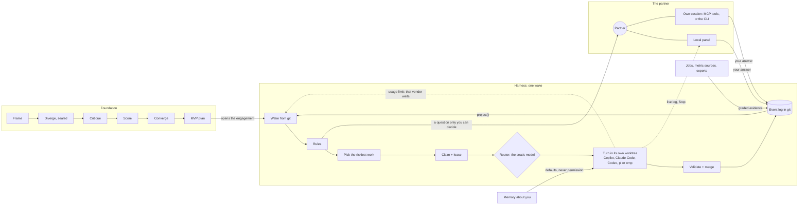

# AgentFactory

A git-native system for running a firm of AI agents with one human partner. It has a shared context layer; a challenge process that takes a hard problem to a tested MVP; a long-running harness that keeps engagements moving for months without a human acting as the clock; an Observator → Solver → Evaluator self-evolution loop; decision rights that route each decision to its owner (client, partner or lead); a role factory that staffs teams from a tested library; and an escalation policy that only brings key decisions to a human. The delivery loop is modeled on the RulTriX RSCL/Raee concept and built on plain git. The full design is in the "Agent firm design" doc.

<p align="center"></p>

<details>
<summary>The same picture as text (Mermaid)</summary>



</details>

This repo is the MVP. Zero dependencies. Node ≥ 22.18 (built-in TypeScript stripping, `node:sqlite`, `node:test`) and git ≥ 2.32.

```bash
npm test                     # foundation, harness, units, hooks, MCP, factory, load test, end-to-end scenarios
npm run demo:challenge       # the foundation: a challenge from frame to tested MVP
npm run demo:harness         # the long-running harness: six engagements simulated over months
npm run demo                 # the delivery engine (add --verbose for the event log)
```

## Foundation: from a hard problem to a tested MVP

Everything else builds on how a team takes on a challenge: frame it, generate options from different angles, critique them, decide, and build the smallest thing that tests what the decision depends on. Every stage reads and writes typed entries in the shared context layer (`src/foundation/`).

**Entries are claims, not chat.** Each entry has a type, an author and the angle it speaks for, links to what it builds on or attacks, a visibility, and a status:

- types: frame, question, evidence, option, assumption, critique, score, decision, plan, experiment, artifact
- never edited; a change is a new entry that replaces the old one, so the history of what was believed stays intact
- stored as files in git, so they're versioned and reviewable

**Angles are configured, not role-played.** An angle in `policy/angles.json` sets:

- what it's scored on (its objective)
- which evidence it reads (tags)
- which model family runs it

A prompt like "be the skeptic" changes the voice; different objectives, evidence and models change the reasoning.

**Divergence is sealed.** Angles that see each other's ideas anchor on the first plausible one, the same reason people generating ideas alone beat interactive brainstorming groups. Each angle's submission goes to its own git ref, `refs/sealed/<challenge>/<angle>`, never to the main line, and only a hash of it is recorded there. At reveal every submission is checked against its hash and all of them land in one commit. A submission changed after its commitment fails the check, and a second submission from the same angle is refused.

| Stage | Gate | What it prevents |
|---|---|---|
| Frame | the owner confirms the problem and criteria before any option exists; a challenger angle questions the frame first | solving the wrong problem; moving the goalposts later |
| Diverge | sealed; refs to anything outside the angle's view are refused; option budget per angle | anchoring, peeking, idea floods |
| Critique | never critique your own option; a critique needs evidence or a test, or it's discarded | self-review, critique theater |
| Score | never score your own option; scores must carry the frozen criteria hash | self-promotion, shifting criteria |
| Converge | only the owner decides; every rejected option needs a reason; scores inform but never pick | voting among agents whose errors are correlated |
| Plan MVP | assumptions ranked by risk × uncertainty; the top ones become versioned basis | building what's easy instead of testing what's risky |
| Experiment | a refuted assumption reopens the decision built on it, asks the owner, and marks pinned work stale | carrying on after the premise broke |

Claims are fact-checked by lookup: `repo:` sources must exist, `entry:` sources must resolve, and prose sources stay "unverified".

**The first challenge** is a real AgentFactory design question: how the cross-repo contract registry should work (`challenges/contract-registry.json`). `npm run demo:challenge` runs it from a fixture script and writes the full record to `challenges/out/contract-registry.md`. The fixture was written by one author to exercise the gates, including deliberate violations: a peek at another angle's option, an over-budget option, a self-critique, a critique with nothing behind it, a self-score and a stale criteria hash. Its content has none of the independence of a real run.

**Running a challenge for real** with model-backed angles, one owner gate at a time. Each angle runs as a fresh headless Copilot CLI session that sees only its own view and can't write files:

```bash
npm run challenge -- start challenges/contract-registry.json --runner copilot
npm run challenge -- confirm --by partner                # optionally --reframe "..."
npm run challenge -- decide --by partner --chosen <option> --reject "<option>=<reason>" ...
npm run challenge -- build
npm run challenge -- experiment --assumption <id> --result supported|refuted --method "..." --evidence "..."
npm run challenge -- report
```

State lives in git under `.af/<challenge>/`, so each command picks up where the last stopped. Model names in `policy/angles.json` (`model-a`, `model-b`, `model-c`) are placeholders; set them to the families your Copilot plan offers, and give angles that must disagree different families.

## Long-running harness: from MVP to months of work

After the challenge decides, the harness keeps the engagement moving (`src/harness/`, design and findings in [docs/harness.md](docs/harness.md)). Each wake starts from git, does at most a few bounded turns, checks them independently, commits, and says when to wake next. A person is asked only for decisions that are theirs, for money, and for work only a person can do.


That walk-through of one turn also plays in a browser from `docs/architecture.html`.

What it rests on:
- **Belief is computed from evidence, never claimed.** Agents can record opinions and sourced reports; measurements come from jobs, behavior from metric sources, expert judgment from people listed as experts. Each kind of risk accepts its own grades (behavior for demand, experts for safety).
- **The riskiest open assumption picks the next work**, so the phase (demand, feasibility, compliance...) is derived, not configured. Work that assumes something waits until it's supported.
- **Questions block only what depends on them.** Everything else keeps moving while a regulator, a lawyer or another team takes weeks.
- **Spin is measured by outcome**: three turns without evidence or checked output force a replan; every todo has a turn cap; failed turns still cost.
- **Waiting is free**: jobs, market tests, calendar freezes and people's answers cost no turns, and a quiet wake is one `git ls-remote`.
- **The team follows the work.** Each lane with open work in a goal gets a seat, staffed from the firm library (researcher, builder, experimenter, strategist...) with permissions filtered through the catalog. A lane the library doesn't cover gets a generated role with the least access, on probation: an independent reviewer on another model checks its work unless a checker or a named person already does.

It was designed against six engagements, simulated end to end through the real code: an Unreal-6-scale engine, Starship 3D-printing kits for kids, a medicine assistant for seniors, a legacy migration, an open research question, and perpetual library maintenance. The simulations found ten design flaws, each fixed and now covered by a test.

## Components

| Component | File | What it does | Production swap |
|---|---|---|---|
| Git substrate | `src/git.ts` | Worktrees, commit trailers (`Agent`, `Basis`, `Config`, `Replay`, `Decision`), leases as refs under `refs/leases/<path>` acquired by one atomic push with `--force-with-lease=<ref>:` | GitHub Enterprise remote; same mechanics |
| Entries and sealed reveal | `src/foundation/entries.ts`, `seal.ts` | Typed append-only claims; per-angle sealed refs with hash commitments; views scoped by angle and evidence tags; dependents across versions | Same |
| Partner's panel | `src/panel/` | One local page over every engagement: the questions waiting on you, answered in place; per engagement, its beliefs, budget, open work, team and recent turns, the loop's last wake; pause, resume, a new budget. Reads and writes the same event log as the CLI | Same, plus a sign-in to reach it from a phone |
| Long-running harness | `src/harness/` | Event log in git, in causal order; beliefs from graded evidence; risk-ordered selection; dependency-scoped gates; claims as refs; jobs, waits, actions, monitors; kill criteria, budgets, spin and turn caps; seats staffed per lane from the library, generated roles on probation; deterministic handoff packet; tick/loop CLI; Copilot CLI and Claude Code turn agents run as the seat, routed by model; usage limits waited out per vendor; live turn logs and stop; six simulated cases | Real job/metric providers (GitHub Actions, analytics) behind the same interfaces; a model-backed role generator behind the same limits |
| Challenge process | `src/foundation/process.ts`, `runners.ts`, `cli.ts` | Frame → diverge → reveal → critique → score → converge → plan MVP → build → experiment, with the gates above; scripted and Copilot CLI angle runners | Same, with the Copilot SDK |
| Shared context layer | `src/context.ts` | Versioned task basis, content-addressed source snapshots, per-role context bundles, `context.lock.json` per artifact | Same files; snapshot importers per source system |
| Decision records | `src/decisions.ts` | Chosen + rejected options, bound paths, staleness when bound paths change | Same |
| Index | `src/store.ts` | SQLite index rebuilt from committed git objects; disposable | Postgres fed by webhooks |
| Observator | `src/observator.ts` | Breakpoints = artifacts pinned to a superseded basis. A query, no model call | Same, plus an LLM pass for unpinned artifacts |
| Solver | `src/solver.ts` | Context Portfolio from a breakpoint or config change; freezes the criteria hash before any candidate exists | `solver` custom agent for non-trivial revisions |
| Evaluator | `src/evaluator.ts` | Replays baseline vs candidate at a frozen commit, N runs per side in parallel; checks outcome, red lines, cost; rejects candidates that touch protected files; engagement-specific checkers plug in by name | Same, runs on CI runners |
| Fact-checker | `src/factcheck.ts` | Verifies claims by lookup (basis version, decision freshness, contract registry, CI result, file presence) | `fact-checker` agent maps free text to claim kinds |
| Policy | `src/policy.ts`, `policy/escalation-policy.json` | Triage (triggers, auto-resolve conditions, evolution rules, `never_auto` floor), decision rights and owner routing, engagement profiles, attention budget with backpressure | Same |
| Role factory | `src/factory.ts`, `src/harness/team.ts`, `policy/library.json`, `policy/permission-catalog.json` | Staffs a team from library templates, one agent per module, and the harness's seats lane by lane; generated roles and skills start on probation; permissions only from the catalog, so client text can raise a question but never grant access | Model-backed planner behind the same guardrails |
| Escalation log | `src/escalation-log.ts` | One event file per triage and per brief delivery under `.agents/escalations/<proposal>/`, with a feature snapshot for offline replay and the brief's position in the day; indexed by `store.ts`. Records only, never changes routing. `escalation_quality.miss_cost_ratio` (k = 10) sets the calibration line: escalate when the chance the human changes the outcome is above 1/k | Same |
| Briefs | `src/brief.ts` | One-screen brief, blind variant | Same |
| Trust ledger | `src/ledger.ts` | Per-agent commits, revert rate, line survival (git blame), demotion | Same, plus missed-escalation counts |
| Coordinator | `src/orchestrator.ts` | Concurrency cap, lease → worktree → agent → lockfile → commit → merge queue → release | Temporal workflows (durable waits, retries) |
| Agent runners | `src/agents/` | `MockAgent` (deterministic, tests) and `CopilotCliRunner` (`copilot -p --agent --model --allow-tool --deny-tool`) | Copilot SDK |
| MCP servers | `src/mcp-server.ts`, `src/harness/mcp.ts`, `src/mcp-rpc.ts` | Context layer as MCP tools over stdio, role-scoped, for agents; the partner's harness tools for their own session, refused inside turns; hand-written JSON-RPC | Same, or the official SDK |
| Copilot CLI integration | `integrations/copilot/` | Custom agents, hooks (`preToolUse` lease enforcement, `sessionEnd` lockfile), MCP config | Copy into your repo |

## The test scenario

1. Three agents build in parallel on basis v1 (enterprise + individual). The analyzer and a docs task overlap on `tools/`, so one waits for the lease.
2. Narrowing scope to enterprise-only is a basis change, so it escalates and the human gets a brief (and a blind variant). The human approves it, which writes basis v2 and decision D-0002.
3. agent-01 rebuilds the report on v2; agent-03 doesn't.
4. The Observator finds exactly one breakpoint: the analyzer is pinned to `scope@v1`.
5. The Solver proposes a portfolio and the Evaluator replays it 3 runs per side. The baseline passes 0% (individual records present). The candidate passes 100% at lower cost. All claims verify by lookup, the policy auto-resolves, the fix merges, and the breakpoints drop to zero.
6. The loop refuses what it should:
   - A config that leaks PII is revised once and then passes.
   - A cost regression (+150%) has no remedy, so it escalates.
   - A candidate that edits the frozen criteria is rejected.
   - A criteria-edit PR hits the `never_auto` floor.
   - A contract change with an unverifiable consumer claim plus dissent escalates, with both shown in the brief.
7. Trust ledger: reverting agent-04's commit demotes it, computed from git history alone. A decision goes stale when its bound path is edited.
8. Attention budget: 8 briefs a day are delivered, 2 are queued, interrupts bypass the cap, and backpressure turns on.
9. Lease atomicity: an overlapping lease is refused by the pre-check, and also by git itself when the pre-check is bypassed. Expired leases are reaped.

Plus a load test (12 agents, 4 slots, overlapping paths: no overlapping holders, every change merges, history is linear, every lease is released) and role-factory tests (one agent per module, injected access requests become questions, generated skills on probation, hand-edited plans rejected).

## Private engagements

An engagement that holds client-confidential material keeps its code in `src/<name>/`, its SOW and client files in `engagements/<name>/`, and its tests in `test/<name>.test.ts`. List those paths in `.git/info/exclude`, git's local-only ignore file, so they stay in your copy and the public repo never even names them. `npm test` runs their tests whenever they're present.

## What testing found

- **Worktree race:** parallel `git worktree add` in one repo can read another's half-written admin directory. Worktree add/remove is now serialized per repo; agent runs stay parallel.
- **Tracking-ref race:** `git push` rewrites the local `origin/main` tracking ref, which races with concurrent fetches. Push and fetch share the per-repo lock. This failed about 1 in 12 runs before the fix; it passed 25 of 25 after.
- **Tamper check miss:** trimming `git status --porcelain` output dropped the first file's status column, so the tamper check missed the edit. It now parses `-z` output untrimmed.
- **Replay noise is real:** a flaky candidate passed with 1 run per side and failed with 5 runs per side (40%). Use several runs per side, or let deterministic checks decide.
- **Returns are the wrong test for rule-following work:** in a private engagement, a config that ignored a rule earned 43% more on the backtest. A returns-based evaluator would have adopted it; the rule-fidelity checker refused it.

## Memory about the people you serve

Remembering more isn't understanding more. "I like red-eye flights" (said three months ago) and "maybe Tokyo this weekend" (said yesterday) differ in how long they hold, how sure we are, and what they let an agent do. `src/memory/` keeps what a principal (you, a client) has said and done as a log of evidence. What we currently believe about them is computed when it's read, the way the harness computes beliefs from graded evidence.

Each entry records five things:
- **What kind of thing it is:** a preference, an intention, a fact or a constraint.
- **How we know it:** stated or chosen by them, or, recorded by an agent, inferred or accepted.
- **When it holds:** a condition, such as "on short business trips".
- **Why,** when known.
- **Until when.**

The rules:
- **Memory never grants permission.** An item's use is `default` (fill in or rank what you were asked to do), `mention` (worth a question when relevant) or `ask` (check first). There's no "act". Text that reads like a permission ("always book the cheapest without asking") is kept as a default and flagged.
- **Agents can't make things true about you.** They record guesses ("inferred") and acceptances of their suggestions ("accepted"). Only you state or choose.
- **Our own influence isn't evidence.** Accepting a suggestion we made adds nothing to the preference behind it, so recommendations can't feed on themselves.
- **Things expire.** Intentions lapse at their date (14 days if none is given), preferences fade unless repeated (half-life 180 days, `policy/memory.json`), and an old guess goes stale.
- **A condition narrows a preference instead of overwriting it.** "Red-eye on business trips" and "daytime with the kids" are two answers.
- **Two things that disagree become a question, not an average.** Saying that one replaces the other settles it, and forgetting the replacement brings the old one back.

```bash
npm run memory -- add --as principal --kind preference --subject travel.flight-time --value red-eye --text "I like red-eye flights" --condition "short business trips" --because "it saves a hotel night"
npm run memory -- add --as principal --kind intention --subject travel.trip --text "Maybe Tokyo this weekend" --until 2026-11-01
npm run memory -- view                                   # what we believe now, how we know it, what it may be used for
npm run memory -- render --subjects "work.*" --out profile.md   # a self-profile for your coding agents, regenerated, never stale
```

An engagement opts in with `"memory": { "principal": "partner", "subjects": ["work.*"] }` and `open --memory <dir>`. Its agents then get, in their packet, the defaults that apply on those subjects and what to check with you first. Lapsed plans and other subjects are left out.

## Running the harness on Windows

The harness runs as you, on your machine, through Task Scheduler: your Copilot CLI sign-in, your git credentials, and the engagement's code never leave it. Needs Node 22.18 or later, Git for Windows, and Copilot CLI (`npm install -g @github/copilot` or WinGet) signed in once with `copilot`.

```powershell
git clone https://github.com/AJ999999999/AgentFactory C:\workspace\AgentFactory
cd C:\workspace\AgentFactory; npm test          # the suite runs on Windows in CI too
npm run harness -- agents install                 # Copilot agent profiles for the library roles, in %USERPROFILE%\.copilot\agents

# A folder for engagements (state lives in each engagement's own git repo)
mkdir C:\workspace\engagements; cd C:\workspace\engagements
node C:\workspace\AgentFactory\src\harness\cli.ts open my-engagement\engagement.json --world my-engagement\world.mjs --seed my-engagement\seed
node C:\workspace\AgentFactory\src\harness\cli.ts doctor
powershell -ExecutionPolicy Bypass -File C:\workspace\AgentFactory\scripts\windows\install-harness-task.ps1 -Engagement my-engagement
```

What the task does:
- **It keeps one `harness loop` alive.** It starts at logon and is retried every 15 minutes. A retry while the loop is running is ignored, so a crashed loop is back within 15 minutes.
- **It runs only while you're logged on** (a locked screen is fine). That's what lets it use your stored credentials. Nothing runs while the machine sleeps; the loop sleeps by the wall clock and catches up on wake.
- **Quiet rechecks are cheap.** The loop rechecks every 10 minutes (`-PollMinutes`) so your answers are picked up, and a recheck with nothing new is one `git ls-remote`. It runs on battery, hidden, and logs to `.af\harness\<engagement>\loop.log`.
- **It rides out network drops.** Offline or off the VPN, it backs off and retries instead of exiting.

`open` takes the engagement's world module (its checkers, saved so the scheduled loop uses them too) and a folder of files to seed into the engagement repo, such as a brief the agents read. Without `--remote`, state lives in a local git repo under `.af\harness\`. You answer questions with `answer <ask> --choice <id>`, adding `--result supports|refutes --metrics name=value` when you're reporting what you observed. An answer counts as yours; add `--by <role>` only when you're passing on what that person (the parent, the lawyer) told you, so it counts as theirs.

### Which CLI and model run a seat

The library gives each role a model placeholder, and `"models"` in `policy/harness-agents.json` says what runs it:
- **Empty:** Copilot CLI with its default model.
- **A Copilot model id:** that model. Some Copilot plans offer a single model and refuse `--model`.
- **`claude:<model>`**, such as `claude:opus`: Claude Code.
- **`codex:<model>`:** Codex CLI.
- **`pi:<provider/model>`:** pi.
- **`omp:<model>`:** omp.

`<cli>:` alone uses that CLI's default model. By default the judges' placeholder, `model-b`, is `claude:opus`, because judges must not run on the same model as the work they judge. `doctor` shows what each placeholder runs on and checks each CLI is installed. To try another CLI for one run without editing the policy, pass `--models model-a=pi:` to `tick`.

Every CLI gets the same prompt and the role's profile as its standing instructions. None of them loads your own settings, MCP servers, plugins, skills or saved sessions, where the CLI lets those be switched off. The `"cli"` section maps the permission catalog onto each one, as strictly as that CLI allows:

| CLI | How a seat is held to what the catalog grants |
|---|---|
| Copilot | `--allow-tool` and `--deny-tool` for each permission |
| Claude Code | allowed and disallowed tools; anything else is refused, never asked about |
| Codex | its sandbox: read-only for a seat that can't write, otherwise writes only inside the worktree with `.git` protected, and no network unless the seat may read the web. It runs any command inside that sandbox, so `doctor` warns that the catalog's command list isn't enforced. |
| pi, omp | a gate the harness loads into every turn (`integrations/pi/turn-gate.ts`). It allows the seat's tools only, and shell commands only from the seat's list, one at a time: no chaining, pipes or redirection. Writes stay inside the write scope and nothing outside the worktree can be touched. A broken or missing grant blocks everything. |

Whatever the CLI, a turn can't push: `git push` to the engagement's remote goes nowhere from inside a turn, and only the harness merges a turn's work, after checking it. Each CLI must be installed and signed in on the same PC.

### Usage limits

A usage or rate limit isn't a failure of the work. When a CLI refuses for capacity:
- the turn is thrown away and isn't counted against the work or the budget
- only the seats on that vendor wait, until the reset time it gives (or 30 minutes, doubling while it keeps refusing)
- the loop wakes at the reset

The other vendor's seats, jobs and people's tasks carry on. The panel shows the wait.

### The panel

```powershell
cd C:\workspace\engagements
node C:\workspace\AgentFactory\src\panel\cli.ts       # or, from the AgentFactory folder: npm run panel -- --dir C:\workspace\engagements
```

It opens a page on this PC (`http://127.0.0.1:4700`) with every engagement in that folder, and in every other folder you've run `harness open` in (the list is kept in `~/.af/panel-folders.json`), so three projects opened in three folders share one page. `--dir <folder>`, repeated as needed, shows only the folders you name. If two folders hold engagements with the same id, each is shown with its folder's name after it.
- **The left column is what's waiting on you**, most urgent and most blocking first. Open a question to answer it. An agent's question carries its recommendation, what follows from each option and which options can't be undone, so most can be answered from the card. When the recommended option can't be undone or the evidence points both ways, the card says to look first and no option answers in one click. An option that needs something from you (a number, the revised goal, what you observed) or can't be undone asks for it first. Your answer counts as yours unless you tick "I'm passing on what they told me", the same as `answer --by <role>`.
- **The right column is each engagement**:
  - when its loop last woke, and a pause button: paused, nothing new starts and running jobs still finish
  - a usage limit it's waiting out, and until when
  - each turn running on this PC: who's on what, the end of its log as it happens, and a Stop button. Stopping kills the agent and throws its changes away, then asks you whether to try that work again or drop it. Every turn's log is kept in `.af\harness\<engagement>\turns\`.
  - per goal, turns spent against the budget (click the total to change it)
  - one mark per assumption, with the riskiest open one spelled out
  - open work, running first
  - the team, with roles on probation dashed
  - the last turns, with failed and thrown-out ones in red

It reads the same event log as `status` and writes through the same code as `answer`, so it never holds state of its own. Writes from the loop, the command line and the panel go through one checkout under a lock shared across processes. It listens on 127.0.0.1 only, refuses requests addressed to any other host, and every call carries a token only the page it served knows. `npm run panel -- --demo` opens it on three simulated engagements.

The same controls are on the command line: `pause [--reason ..]`, `resume`, and `budget <goal> turns=300`.

### From your own Copilot or Claude Code session

The harness's tools are also an MCP server, so you can work the firm from the session you already have open. Its tools are `status`, `open_questions`, `answer`, `add_work`, `pause` and `stop_turn`. It reads and writes the same way the panel does, and covers the same engagements: every folder you've run `harness open` in, or only the folders you name with `--dir`.

```powershell
claude mcp add agentfactory --scope user -- node --no-warnings C:\workspace\AgentFactory\src\harness\mcp.ts
```

For Copilot, add the same command as a `local` server named `agentfactory` in `%USERPROFILE%\.copilot\mcp-config.json`.

These are the partner's tools, never an agent's: an agent that could answer your questions would be grading its own work. So:
- the server offers nothing inside a harness turn
- every Copilot turn switches it off by name
- Claude, Codex and pi turns load none of your MCP servers
- the gate refuses omp turns any tool outside the seat's list

`doctor` checks node, git, Copilot CLI, the agent profiles, the engagement's repo and remote, when the loop last woke, and the task. Each seat runs Copilot as the profile `af-<role>` (`integrations/copilot/harness-agents/`); a profile that isn't installed is skipped rather than failing the turn, with the role in the prompt instead. To stop: `scripts\windows\uninstall-harness-task.ps1 -Engagement my-engagement`; the state stays in git and a reinstall carries on.

Windows-specific handling, each found by reading the code and checked on a Windows CI runner:
- **Copilot's `.cmd` shim is never run through `cmd.exe`.** Prompts carry text from web pages and agents, and `&`, `|` or `%` in them would run commands there. The shim's JavaScript entry is run with node instead.
- **Clones turn off line-ending conversion and turn on long paths.**
- **Worktree removal retries while antivirus or the indexer holds a file.**
- **The Copilot hooks have `powershell` entries, and guard PowerShell's recursive deletes too.**

## Plugging into Copilot CLI

1. Put this project at `tools/agentfactory/` in your repo.
2. Copy `integrations/copilot/.github/*` and `integrations/copilot/.agents/hooks/` to the repo root, and append `.gitignore.snippet` to `.gitignore`.
3. Use `CopilotCliRunner` instead of `MockAgent` in the coordinator.

Check these against your CLI version before relying on them:
- **Tool names:** the hook matches `edit|create|write|str_replace*` for file writes and `bash|shell|powershell` for shell.
- **Hook output:** the hook prints `{"permissionDecision":"allow"|"deny"}`.
- **`model:` in agent frontmatter:** model IDs depend on what your org enables.
- **Programmatic flags:** `--output-format json` and `--no-ask-user`.

## Not real yet

- **Turn agents have run for real only in smoke tests.** These ran on Windows: Copilot CLI 1.0.105, Claude Code 2.1.314, Codex CLI 0.166.0 and pi 1.4.0. The runs covered:
  - writing files in scope
  - a read-only judge turn
  - stopping a turn mid-run, for Copilot and Codex
  - the gate refusing out-of-scope writes, pushes, chained commands and reads outside the worktree inside pi

  They haven't run a real engagement yet.
- **Unverified pieces:**
  - omp has been tested only against a fake binary: its flags come from its help text
  - the wording of real usage-limit errors (the classifier reads the common forms)
  - Copilot's tool name for web reads, and Codex's web search setting
  - the challenge process's `CopilotCliRunner`
- The harness's jobs, metric sources and probes are interfaces with simulated implementations; the cases' agents and people are scripted.
- CI runs the tests on Ubuntu and Windows (`.github/workflows/tests.yml`), but replay checks stand in for an engagement's own CI.
- The coordinator is in-process and not durable.
- The remote is a local bare repo standing in for GitHub.
- Firm-level pieces from the design are not built yet: the control repo with client walls, nested leases for spawned teams, the client channel, staffing and cost ledgers.
- Config is JSON rather than YAML, because there are no dependencies.
- The index runs one git process per file, which is fine for an MVP but slow for a large repo.
- Line survival via blame is O(repo size).
