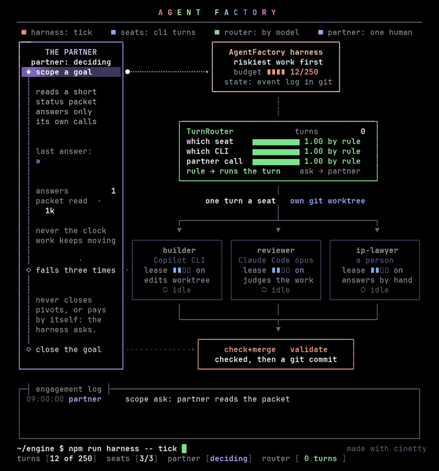

# A terminal animation of one engagement

`docs/cinetty/` holds a 15-second animation of AgentFactory that plays in a terminal. It's made with [cinetty](https://github.com/JosssphZhou/cinetty), a separate tool that turns one filled-in `project.yaml` into an animated diagram. Nothing in AgentFactory depends on it.



The same clip is in `cinetty/agentfactory.en.mp4`, with a Chinese version in `cinetty/agentfactory.zh.mp4` and `.gif`.

It follows one stretch of an engagement, the simulated "Unreal 6 engine" case from `npm run demo:harness`:

1. The partner answers the scope question: narrow it to a stylized renderer.
2. The harness picks the riskiest open work, whether the renderer holds 60 fps.
3. The router sends each seat to its CLI. The builder runs in Copilot CLI. The reviewer runs in Claude Code, because judges must run on a different model from the work they judge. The name check goes to a person, the IP lawyer.
4. The builder's page fails the check three times on the trademark red line. After three failures the harness stops retrying and asks the partner whether to retry or drop it.
5. The partner says to drop the brand and retry. The builder's benchmark comes back measured.
6. The harness never closes a goal by itself, so it asks. The partner closes it, and the events are committed to git.

The structure and the rules shown are the real ones. The clock, the turn counter and the "packet read" counter are illustrative. Each router bar is 1.00 when a rule decides and 0.00 when the call isn't the harness's to make. The harness doesn't use probabilities.

## Playing it

It needs Python 3.12 or newer, Bash and Make, on macOS or Linux, in a terminal of at least 90 × 46 cells.

```bash
git clone https://github.com/JosssphZhou/cinetty && cd cinetty && make setup
```

```bash
make play INPUT=/path/to/AgentFactory/docs/cinetty/project.en.yaml
```

Use `project.zh.yaml` for the Chinese version and `LOOP=1` to repeat it. `make once INPUT=... AT=7` prints one moment as text. After you change a file, `make check INPUT=... FORMAT=json` lists anything that won't fit. To keep a clip, record the terminal, or render one as below.

## How the clip was made

The GIF and MP4 aren't a screen recording. `scripts/render-cinetty-clip.py` asks cinetty's engine for every frame at 30 fps, draws each one the way a terminal would (JetBrains Mono, black background, block glyphs as boxes so the bars stay seamless), and ffmpeg joins them. So no frames are dropped, and the result is the same on any machine. Run it again after you change a `project.yaml`:

```bash
/path/to/cinetty/.venv/bin/python scripts/render-cinetty-clip.py /path/to/cinetty docs/cinetty/project.en.yaml
```

It runs with the Python in cinetty's `.venv`, which `make setup` gives Pillow. It also needs ffmpeg, and the JetBrains Mono and WenQuanYi Zen Hei fonts; set `CINETTY_FONT_DIR` and `CINETTY_CJK_FONT` if yours are elsewhere.
