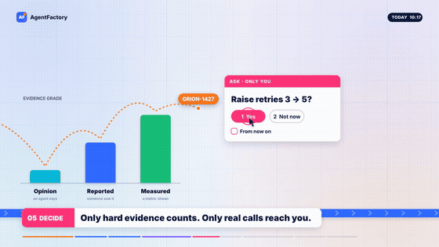

# A 47-second film: today and next

`docs/film/` holds a short film about AgentFactory, in English and in Chinese. It follows one Jira ticket through the firm in a single camera move. Then the camera pulls back to show a thousand engagements running at once, and ends on the one decision left for you.



The full films are `film/agentfactory.en.mp4` and `film/agentfactory.zh.mp4`: 1080p with music, about 6 MB each. The GIFs are seven seconds from the middle.

## What it shows, and what's real

The ticket, its id, the code and the numbers are made up. It's a payments bug, `PAY-4127 · Checkout webhooks time out (EU)`, and `PAY-712` in the Chinese cut. Each step stands for something AgentFactory does today:

1. **Intake.** A ticket comes in from Jira, next to a support ticket and a production alert: [events from outside](events.md) and the probes in [harness design](harness.md).
2. **Log.** Each one is written once to the engagement's event log, which lives in git.
3. **Route.** A rule turns the ticket into work in one lane, and the riskiest work goes first.
4. **Review.** A worker seat does the work, and a judge on a different model reviews it. `checkLibrary` refuses a policy where the two share a model.
5. **Decide.** Belief comes only from graded evidence: an agent's opinion, then something reported, then a measurement. A question that's yours reaches you once, and "from now on" makes the answer a standing rule. See [the harness's questions on Slack](harness-slack.md).
6. **Ship.** The work goes up as a pull request, and its checks and the review on another model run. It merges once you approve. The loop never approves or merges by itself. See [done work as pull requests](ship.md).

The last two steps are where it's going, not what it does today:

7. **Scale.** A thousand engagements, each waking on its own timer, with a quiet wake costing almost nothing.
8. **Learn.** Every answer is kept, so it asks you less and less, down to the calls that are only yours.

The clock, the counts and the pacing are illustrative.

## Rendering it

The film is code: `scripts/film/film.js` draws every frame as a function of time, and `make_en.py` builds the English cut from it. `music.py` synthesises the score, with each accent on something that happens on screen. `render.py` puts the frames, the music and the encoding together.

It needs Python 3.10 or newer and ffmpeg.

```bash
pip install playwright numpy scipy
```

```bash
playwright install chromium
```

```bash
python scripts/film/render.py en
```

Use `zh` for the Chinese cut and `--workers N` to set how many browsers render in parallel. It takes about a minute and a half with four. To check a change without a full render, `--preview 12 28.5` writes those moments as stills to `scripts/film/.cache/preview/`. The Chinese font, Noto Sans SC (SIL Open Font License), is downloaded into that cache the first time.

The render pipeline and the music's instruments follow [motion-atlas](https://github.com/skylarzzzz/motion-atlas) (MIT, `scripts/film/LICENSE-motion-atlas`).
